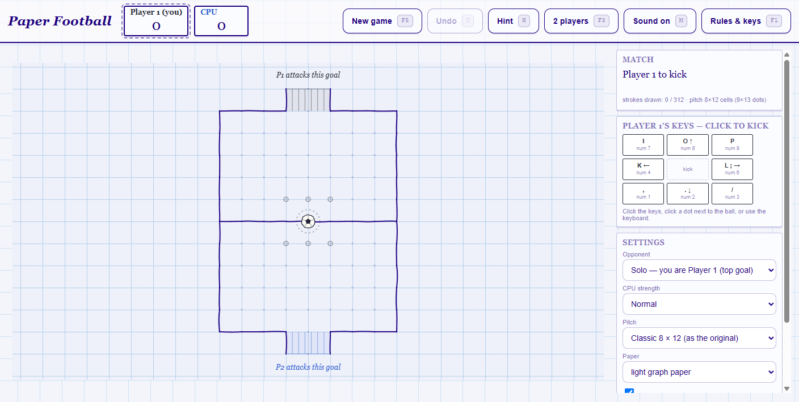
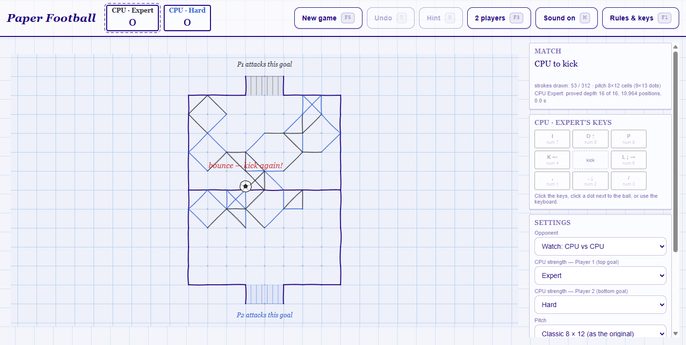
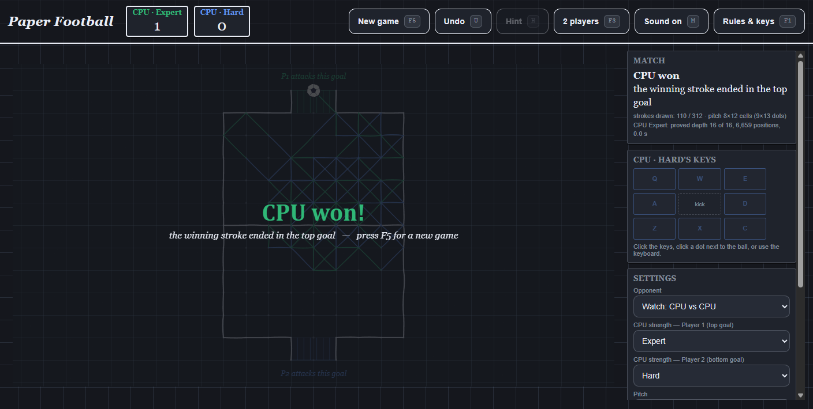

# Paper Football — open `index.html`

A rewrite of [`football.pyw`](football.pyw) in plain HTML + JavaScript: the same pen-on-graph-paper game, the
same pitch, complete rules, and a CPU that actually plays the game instead of wandering toward a goal. Rules of
the original were reverse-engineered first and are written up in [RULES.md](RULES.md); this implements them with
the ambiguities resolved (see [Deliberate changes](#deliberate-changes)).

The game is four files and nothing else: [`index.html`](index.html) is the markup, [`game.css`](game.css) the
paper, [`engine.js`](engine.js) the rules and the search, [`app.js`](app.js) the drawing and the controller.
No CDN, no build step, no image or sound file required — the ball is drawn as an ink sketch on the canvas and
the kick is synthesised with WebAudio. Open `index.html` straight from disk; it does not need a server. If you
do serve the folder over http, the original `kick (1..3).wav` files are picked up automatically.

## Open it

Double-click [`index.html`](index.html), or drag it into a browser. To also get the original kick samples:

```
python -m http.server 8000     # then open http://127.0.0.1:8000/index.html
```

Three URL hashes change how the page opens, without touching your saved settings: `index.html#demo` starts a
CPU vs CPU game you can watch, `index.html#level=hard` (or `easy`, `normal`, `expert`, `master`) picks the
strength for that opening, and `index.html#dark` opens it on dark paper. Combine them:
`index.html#demo#level=master`.

The whole window is one sheet of graph paper — the page background grid is re-scaled to the pitch grid,
and the pitch is drawn centred on the sheet, as it would be on a real exercise page. Player 1 plays with a
graphite pencil a shade off black, Player 2 with a blue pen — the two pens this game is actually played with,
the first one kept light enough that the strokes still read as drawn on paper rather than printed on it.



A demo game in progress, opened with `#demo` — the CPU playing both sides, one pen each. The two lines under the
status say what it is really doing: the first is the search that decided the last kick (proved to 16 plies,
101 352 positions, 0.1 s), the second is the search running right now, written while it works — 15 of 16 plies
so far. The red "bounce — kick again!" is the only thing still in red, because it describes the state of the ball
rather than who is winning:



The same finished demo on dark paper, where graphite would be invisible so the two pens are a deep green and a
deep blue — opened with `#dark` or chosen under Settings → Paper:



## Keys

| | up-left / up / up-right | left / right | down-left / down / down-right |
|---|---|---|---|
| **Player 1** (attacks the **top** goal) | `I` `O` `P` | `K` `L` (or `;`) | `,` `.` `/` |
| **Player 1**, number pad | `Num 7` `Num 8` `Num 9` | `Num 4` `Num 6` | `Num 1` `Num 2` `Num 3` |
| **Player 1**, straight only | `↑` | `←` `→` | `↓` |
| **Player 2** (attacks the **bottom** goal) | `Q` `W` `E` | `A` `D` | `Z` `X` `C` |

The two clusters are the mirror of each other — left hand for Player 2, right hand (or the number pad) for
Player 1, so a laptop without a number pad still gets a full 8-direction pad. Binding is by physical key,
so any keyboard layout works; the arrow keys are only an extra Player 1 binding.

Other keys: `H` hint (or `T`) · `F3` switch Player 2 ↔ CPU · `F5` new game · `U` undo · `M` sound ·
`F1` rules and keys · `Esc` close. A bare `F5` restarts the match instead of reloading the page;
`Ctrl`+`F5` and `Ctrl`+`R` still reload it, which is why the old single-key `R` binding is gone. The rules
panel is on `F1` rather than the usual `?` because `/` and `?` are Player 1 keys here. Every key action also
exists as a button, an on-screen 3×3 key pad, or a click/tap on the hollow dot you want to kick to.

## Settings

* **Opponent** — solo as Player 1 or Player 2, two players on one keyboard, or CPU vs CPU to watch.
* **CPU strength** — `easy`, `normal`, `hard`, `expert`, `master`, named plainly in the menu; the depths and
  thinking times behind them are in [The CPU](#the-cpu). Normal is the default.
* **Pitch** — small 6 × 10, classic 8 × 12 (the original board, with the area outside its border taken out
  of play), big 10 × 16.
* **Show legal dots** — the faint rings next to the ball; turn them off for a real pen-and-paper feel.
* **Paper** — light graph paper (the default, close to the original's look: Player 1 in a graphite pencil a
  shade off its black, Player 2 in a lighter ballpoint blue (#2f5fd0), never mistaken for the printed pitch), dark paper (Player 1 in a deep green pencil, Player 2 in a
  deep blue — graphite would be invisible there, and pastels stop looking like pencil), or follow the system's
  light/dark setting. The canvas, the panels and the page grid all
  switch together, and the switch is instant: the sheet is re-drawn, not re-loaded.

Settings and the pitch you chose are remembered in `localStorage`. Three things are deliberately **not**
settings: the next goal wins, an own goal always scores for the other side, and the printed border really is
the pitch — the first two are how the game is actually played, and the third is what makes the field mean
something, so they are rules here, not options (see [Deliberate changes](#deliberate-changes)). The tests
assert the exact breakdown: on the classic board 44 of the 404 lattice segments are drawn, 48 more lie outside
that border and are blocked without being drawn, which leaves 312 playable.

## The CPU

The engine is a full game-tree search, not a distance heuristic:

* negamax with fail-soft alpha–beta, principal-variation search at internal nodes, aspiration windows at the
  root, iterative deepening, a zobrist-keyed transposition table (verified with a second hash), move ordering
  (TT move → goal → avoid own goal → bounce → toward the target goal), and a hard per-move time budget.
* **The search is not started over on every move.** One table is kept for the whole match, the position the
  CPU is actually asked to play is stored in it like any other, and a search begins one ply past whatever is
  already proved there — re-walking a depth that is already proved proves nothing new. A position the engine
  has already worked out is then answered out of the table without looking at a single new position; the suite
  asserts that contract by name (no search, the table's proof depth reported, the same move and the same
  score), and the page says it in words — that the answer came out of a proof made during an earlier
  kick, naming the depth that proof reached — instead of printing a depth of 1 for it. Measured on four
  positions of one real game in order: one table kept looks at 28–30 % fewer positions than an empty table for
  each. It shows on the page too: a whole CPU-vs-CPU demo match at Expert plays out in well under a minute on
  this machine, and the move that ends one of those games examined not one new position — which is what the
  status line in the screenshots below says.
* **The bounce chain is in the tree.** Landing on a lined dot means the *same* player kicks again, so the
  tree does not alternate; the search keeps the same maximising node instead of negating, which is exactly
  the tactical idea the original CPU could not see. The test suite has a position where `hard` walks a
  bounce ladder into the net in one turn.
* The leaf evaluation is one BFS over still-blank strokes: how many kicks each side is from each goal,
  plus how many strokes are still available next to the ball. Mate distances are stored and re-based
  through the transposition table, so a forced win is preferred earlier and a loss later.
* **The thinking is sliced, not threaded.** The search runs on the page's own thread in slices of about 60 ms,
  yielding to the browser between them, so the paper keeps drawing and the depth it has proved so far is
  written on the page while it thinks. It is not in a worker, because the game is published as files to open
  from disk and a page opened that way cannot start one. Measured in current Chrome from a `file://` page:

  | what the page tries | what happens |
  |---|---|
  | `new Worker('engine.js')` | throws — the script cannot be accessed from origin `null` |
  | `new Worker(blobUrl)` with the engine text in a Blob | constructs, and never runs |
  | `importScripts('engine.js')` | throws — invalid URL |
  | `fetch('engine.js')`, `XMLHttpRequest` | rejected, failed to load |
  | `SharedArrayBuffer` | `undefined` — no shared-memory route either |
  | `navigator.hardwareConcurrency` | 16 cores, unreachable from this page |

  [Threads](#threads) says what they would have bought, and why that is still not worth giving up the
  double-click for.

* A level is a **proved depth plus a clock**, and the depths were picked from what this search can actually
  prove — not from what sounds impressive. `tools/ladder.mjs` measures it on the classic pitch (one thread,
  empty table, the opening plus four positions taken along one 163-stroke game):

  | rung | proved depth | clock | what that costs, measured |
  |---|---|---|---|
  | `easy` | no search: random among moves that do not lose on the spot, and it takes a free goal | — | — |
  | `normal` | 6 | 0.5 s | ~1 ms mid-game, proved at every position sampled — about what the original CPU was reaching for, but with you in the loop |
  | `hard` | 12 | 1.0 s | 22 ms median, proved at 4 of the 5 positions — the fifth was solved at depth 9 |
  | `expert` | 16 | 1.5 s | 159 ms median, proved at 3 of 5; two of those positions were themselves proved at 9 and 13 and stopped on their own |
  | `master` | no ceiling it can reach (26) | 3.5 s | asked at a cap of 20 the ceiling is proved at 1 of 5 positions, at 22 and 24 at none — median 17 plies, and the clock ends the search |

  With no ceiling in the way, 200 / 400 / 800 / 1600 / 3200 ms of thinking proved a median depth of
  13 / 14 / 15 / 16 / 17 on that sample — one extra ply per doubling of the clock. That law is what the
  rungs are placed by where the clock is the binding constraint: `normal` and `hard` are defined by a depth
  they can prove well inside their clock, `expert` by one it can still prove inside 1.5 s but only just, and
  `master` has no ceiling it can reach at 3.5 s, so its strength is the clock itself. The absolute numbers
  depend on which positions a sample contains (this one includes two positions whose line to a goal was
  *proved* at depth 9 and 13, so the search stopped there whatever the clock allowed, and they drag the
  median down); the slope is what repeats from sample to sample. The old Hard → Expert step claimed six plies
  and 32×, and it was fictional in both directions: 12 and 18 were each proved in well under a second
  inside their budgets, so the two levels played the same game. The suite asserts reachability on its own
  position as well: depth 6 in 0 ms, 12 in 13 ms, 16 in 84 ms, and `master` proving 19 plies when its 3.5 s
  ran out — which is the depth that rung actually plays at, and what the status line prints.

  The top rung used to be called `expert`; it is now `master`, and `expert` is a new rung below it — a
  remembered `expert` setting is therefore stronger than the old `hard` but weaker than the old `expert`, and
  `master` gives the old strength back. A saved setting naming a level that no longer exists falls back to
  `normal`.

  The suite asserts that this ladder is real rather than printed: five rungs, each deeper and slower than the
  one below, the Hard → Expert step at most four plies, bare names in the menu, `normal` still at six plies —
  and, measured on a mid-game position with an empty table, asked exactly the way the page asks (no depth
  override), each ceiling actually proved inside its own clock: `hard` 45 ms, `expert` 370 ms in the run whose
  numbers are in the table above. `master` is checked for the opposite, that it does *not* reach its ceiling
  and that the clock is what stops it. The status line reports depth, positions searched and thinking time of
  every CPU move, so the difference between levels is visible on the paper rather than only in this file.
* `normal`, `hard`, `expert` and `master` play the same answer from the same position. When several strokes score
  exactly the same the CPU keeps the order the search sorted them in — goal, avoiding own goals, keeping
  the bounce tempo — instead of drawing one out of a hat; only `easy` varies its play. This also makes the
  test suite reproducible on a busy machine (an earlier version picked randomly among equal moves and a
  tactical test then failed depending on load).

Measured on an idle machine, one run of `node tools/selftest.mjs`: sudden-death matches on the classic pitch,
colours alternated, **each side given the clock its own rung ships with** — because that is what a player
meets, and it is why this replaced a table where the stronger side was handed 1.2 s whatever its level claimed.
The two pairings the suite *asserts* play four games each, because an assertion has to survive one unlucky game:
a two-game version of `easy` vs `master` measured 1 – 1 once, which proved nothing either way. The two
report-only pairings involving the top rung play two games, since that rung spends its whole clock on every wide
position. The depth column is the **mean over the moves that side actually played**: a whole game includes the
opening, the widest position there is, so these numbers sit below the per-position ones in the table above.

| pairing | result | strokes/game | mean depth over the game |
|---|---|---|---|
| `easy` vs `master` | master 4 – 0 | ~47 | no search vs 14.8 |
| `easy` vs `normal` | normal 4 – 0 | ~19 | no search vs 5.6 |
| `normal` vs `master` | master 2 – 0 | ~65 | 6.0 vs 19.1 |
| `hard` vs `expert` | **expert 3 – 1** | ~123 | 12.0 vs 15.8 |
| `expert` vs `master` | **expert 2 – 0** | ~60 | 15.5 vs 17.7 |

The fourth row is the reason the rungs were retuned. With the old 12-vs-18 depths that pairing split its games
2 – 2, because both levels were proved in well under their budgets and were therefore playing the same game.
Given their own clocks `expert` took 3 of 4 from `hard` (4 of 4 in the run before this one). The fifth row is
the honest half of the same experiment, and this run says more than the earlier ones did: the side that proved
**17.7** plies lost both games to the side that proved **15.5**; the run before put it the same way at 20.7
against 15.5, and an earlier build drew it 1 – 1. So the
menu is an honest ladder of depth and thinking time — which the status line lets anyone check move by move —
and not a claim that each rung is a meaningfully better player once both are searching properly: above Expert
the clock buys provable depth and, in this many games, has not bought results, which is a finding about this
evaluation rather than a regression. The reason is unchanged: at 12–18 plies negamax happily commits to lines
that only *look* better under a
distance-and-open-space evaluation — a deep search optimising a shallow evaluation. The evaluator is the thing
to improve first (`RULES.md` §10 is written as a prompt-ready spec for exactly that). A time-limited search
also reaches slightly different depths from run to run, and an earlier build of this engine picked *randomly*
among equal-scoring moves, which moved a pairing by a game either way. That is why the suite reports these
pairings instead of asserting them, and why the depth both sides really reached is printed next to the score —
on the paper as well as in the test output.

Since the next goal wins, expect a long game before the one goal that ends it. The way to beat the strong
levels is the way the game is really won: not by shooting, but by leaving the opponent with no stroke left to
draw. The CPU plays that endgame deliberately — expect to lose the paper if you only attack.

### Threads

Sixteen cores are idle while the CPU thinks, and the game uses one of them. That is a consequence of the
publishing choice, not of the engine: the design keeps all the state in plain typed arrays, so the search
parallelises easily — `tools/threads.mjs` runs it as four independent engine instances, each with its own
transposition table, and gives each of them one of the answers at the root with a quarter of the clock, so the
total thinking time per move is exactly what one core gets. On the classic pitch at Master:

```
one core, one table, 3500 ms a move:    won 0 of 2  (median depth proved 20)
4 cores, 4 private tables, 875 ms each: won 2 of 2  (median depth proved per root answer: 18)
avg 85 strokes a game, 0 anomalies
```

The split side scores *every* answer at the root to a median depth of 18; the single core spends the same
wall-clock time proving one line to a median of 20 and leaves the remaining answers merely bounded rather than
proved. Covering the root beat going deeper in both games this tool plays (134 and 35 strokes, colours
alternated, no illegal move), and it came out the same way in an earlier run of it. Two games are a hint, not a
finding, and the same caveat as the ladder pairings applies: at these depths the leaf evaluation decides a lot
of the game. What is not a hint is the cost: each core needs its own table, so the cross-move reuse measured
above — a position already seen costs nothing at all, and a chain of real positions costs 28–30 % less work —
is lost across cores, and the whole thing needs the folder served over http, because a page opened
from disk cannot start a worker at all (the table in [The CPU](#the-cpu) is the measurement). So the shipped
game stays single-threaded and keeps one table for the whole match; the tool stays so the number can be
re-measured by anyone who would rather serve the folder.

## Deliberate changes

Compared with `football.pyw`, these are choices, not accidents (the numbering follows §8 of [RULES.md](RULES.md)):

1. **The printed border is the boundary of the pitch.** The original printed 36 faint diagonal and end-row
   segments beside its posts: decoration, and at the same time the only thing that kept the ball inside the
   field — it left a dozen strokes along the outer edge of its own goal line playable. Here the drawn pitch is
   the touchlines, the half-way line, the goal-area lines and the two short post lines, and the area those
   lines enclose plus the goal mouths is the playing area: strokes that would leave it are blocked without
   being drawn, and the 12 dots outside it are not drawn either. On the classic board 44 segments are drawn,
   48 more are off the pitch, and 312 are playable (the original allowed 324).
2. **No silent pass.** A CPU with a legal stroke always plays one; being stuck loses for the stuck side,
   for the CPU exactly as for a human. The original returned "no move" and simply gave the turn back.
3. **Own goals always score for the other side.** No switch and no "illegal kick" variant — the original
   allowed them by accident, and they are part of the game.
4. **The next goal wins.** No match-length setting and no kick-off: the match ends the moment the ball rests
   in a goal mouth, and that goal line stays exactly where it was drawn. A pitch with no legal stroke left
   ends the same way — the side that cannot kick loses. There is no draw rule.
5. **The pitch size is a setting** instead of depending on your screen size, so "the classic 8 × 12" is a
   reproducible board (404 segments, 44 drawn, 48 off the pitch, 312 playable — asserted by the tests).
6. **Player 1 moved to the number pad / `IOPKL,./` cluster**, Player 2 to `QWE/ASD/ZXC`; the original used
   `QWE/ASD/ZXC` for Player 1.
7. **No external assets needed**: the ball sprite and the kick sound are generated. `ball.png` and the
   `.wav` files are only used when they can be fetched (http serving).
8. The AI delay bug (`1500 - waited*10000`) is gone; the CPU's thinking is sliced and never blocks drawing.
9. **On light paper Player 1 draws in graphite, not green.** The original used green for Player 1 and blue for
   Player 2. The real game is played with one black and one blue pen, and a dark pen reads better on graph
   paper than green does. Player 1's ink is a shade off pure black (#2b2d38), so the strokes read as drawn on
   the sheet rather than printed onto it. Where graphite would be invisible — the dark sheet — Player 1 goes back
   to the original green, kept deep rather than pastel.
10. **The players' strokes are lighter than the printed pitch** — a pencil line drawn over pre-printed graph
    paper is thinner than the print, and keeping the print heavier makes it obvious which lines are not yours.
     Measured against the field: the printed ink 13.4:1, Player 1's graphite 12.0:1, Player 2's blue 5.0:1. The
     pitch stays the darkest thing on the sheet, and the blue is deliberately the lightest line in the game —
     it is the one pen that shares its hue with the print.
11. **The net is drawn inside the goal frame** — between the two short post lines, the way you would actually
    sketch it on paper — instead of hanging outside the pitch.
12. **Dark paper exists** (Settings → Paper, or `#dark`): the same pitch, rules and geometry drawn with a
    green and a deep blue pencil — deep rather than pastel, so they still read as pencil on dark paper.
     Light remains the default.

Unchanged on purpose: the rest of the pitch geometry, the 8-direction single-segment kick, the shared
once-only strokes, the bounce/pass rule, the goal mouth of three dots, and the general ballpoint-on-graph-paper
look.

## Testing it

No dependencies beyond Node (v24 used here). The rules and the search are in [`engine.js`](engine.js), which is
DOM-free: the page loads it with a `<script src>`, and the scripts below load the same file and call it — there
is no test-only copy of the engine that could drift from the one being played.

```
node tools/selftest.mjs           # 97 checks: html/css/js wiring, pitch geometry and its boundary, rules, undo, self-play, the ladder, strength matches
node tools/selftest.mjs --fast    # 90 of them — skips only the strength matches, seconds instead of ~20 minutes
node tools/uismoke.mjs            # 17 checks: boots the interface on a stub DOM, drives the key pad, the hotkeys and the CPU's thinking slices
node tools/ladder.mjs             # proved depth against thinking time, position by position — the source of the ladder table
node tools/bench.mjs normal hard  # what reusing the table across moves saves, move by move
node tools/threads.mjs 2          # the root split across four engine instances against one core; the argument is how many games
node tools/trace.mjs hard 800     # prints what the CPU is thinking in a hand-made position
```

`selftest.mjs` asserts the pitch as it is played here — 404 lattice segments, exactly 44 drawn ones
(20 touchlines, 8 half-way, 12 goal-area lines, 4 posts), 48 more lying outside that border and blocked
without being drawn, 312 playable, and the rule that gives those numbers meaning: no unblocked stroke — not
even at its middle — leaves the printed border, and the dots outside it are exactly the ones marked out of
play, on all three pitch sizes. It also asserts a three-dot goal mouth with its front open, that landing on a
bare dot passes the turn while a lined dot is a bounce, that a dead-end bounce
loses, that an own goal is offered, scores for the other side and loses the match for whoever kicked it in,
that the first goal ends the match with no kick-off, bit-for-bit undo, that every move the CPU produces is
legal, that it never passes, and that games end by the rules. The strength menu is asserted too: exactly
`easy / normal / hard / expert / master`, each rung deeper than the one below it and given more time to get
there, labelled by its name alone, and — the part that was only a printed claim before — every ceiling actually
proved inside its own clock on a mid-game position asked the way the page asks (in the run that produced the
tables above: depth 6 in 0 ms, 12 in 13 ms, 16 in 84 ms), while `master` is asserted to be stopped by the clock
rather than by its ceiling (it had proved 19 of its 26 plies when the 3.5 s ran out). It asserts that a depth
override is honoured, that the deeper rungs measurably cost more work, that a position already proved is answered
out of the table with no search at all, and in the interface smoke test that the page keeps its thinking on the
main thread in slices and never asks for a worker or a second fetch of its own files. What is *not* asserted is
who wins the strength matches: that is a measurement, not a proof, so each pairing prints the depth both sides
reached and the result is reported — and the two pairings the suite does assert, where the weakness is
structural rather than a matter of degree, play four games each so that one lucky game cannot decide them. Run it
on an idle machine if you want the numbers above.

## Files

| file | role |
|---|---|
| [`index.html`](index.html) | the page: markup, settings panel, rules and keys, help — no script or style inside it any more |
| [`game.css`](game.css) | the paper: graph-paper background, the ink colours, the layout and the key pad |
| [`engine.js`](engine.js) | the rules and the search, DOM-free — the browser and the test tools load the same file |
| [`app.js`](app.js) | canvas drawing, input, undo, hints, log, settings, sounds, and the sliced CPU turn |
| [`RULES.md`](RULES.md) | the rules reverse-engineered from the original, plus the open questions |
| [`football.pyw`](football.pyw) | the original pygame version, left untouched |
| [`tools/selftest.mjs`](tools/selftest.mjs) | rules, geometry, interface wiring, self-play and strength checks |
| [`tools/uismoke.mjs`](tools/uismoke.mjs) | interface boot and click-through test with a stub DOM |
| [`tools/ladder.mjs`](tools/ladder.mjs) | what a clock proves: proved depth against thinking time, position by position |
| [`tools/bench.mjs`](tools/bench.mjs) | the same position twice, and a chain of real positions: what reusing the table saves |
| [`tools/threads.mjs`](tools/threads.mjs) | the root split across private engine instances, played against one core |
| [`tools/trace.mjs`](tools/trace.mjs) | ad-hoc: dump the CPU's move scores in one position |
| [`preview.png`](preview.png), [`preview-demo.png`](preview-demo.png), [`preview-dark.png`](preview-dark.png) | screenshots of the page (light, CPU vs CPU, dark), so the look is reviewable without opening the game |

The published repository is only what the game needs: `index.html`, `game.css`, `engine.js`, `app.js`, this
file and `.gitignore`. The links to `RULES.md`, `football.pyw`, `tools/…` and the screenshots therefore point at
files that are not on GitHub — they live in the working copy beside the game, and they are where every number in
this file was measured. Nothing here was measured against a test-only copy of the engine: the browser and the
tools load the same `engine.js`.

## Things it does not do

Two players in the same browser tab only — no accounts, no online play, no board sharing. The search treats
a goal as an instant win at every match length, which is right for "next goal wins" and an over-valuation
in a first-to-5 game (it makes the CPU fight hard for every single goal, which is rarely boring). Undo does
not undo into a different pitch size or mode. The paper is not savable or printable — it is a scratch pad.
